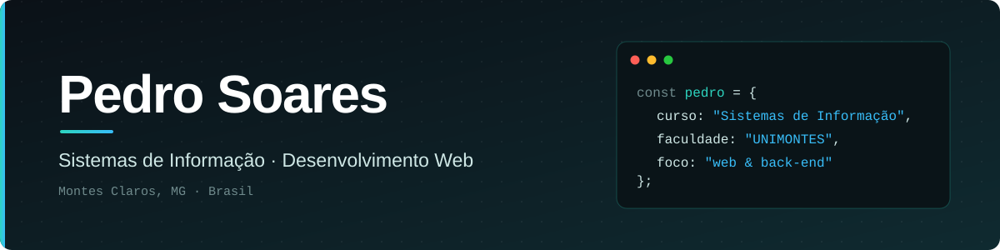

 

 

 

<table>
<tr>
<td width="50%" valign="top">

### 🇧🇷 Sobre mim

Estudante de Sistemas de Informação na Universidade Estadual de Montes Claros (UNIMONTES), com bolsa de desenvolvimento no HUB Digital (LED/CEAD), onde construo ferramentas internas da universidade.

Antes da programação vim do Marketing: sou técnico na área, e isso me ajuda a pensar no produto, na marca e em quem vai usar o que eu faço.

Meu objetivo é crescer como desenvolvedor full-stack, unindo código bem feito e visão de negócio.

📍 Montes Claros, Minas Gerais, Brasil

</td>
<td width="50%" valign="top">

### 🇺🇸 About me

Information Systems student at the State University of Montes Claros (UNIMONTES), with a development scholarship at the university's Digital Hub (LED/CEAD), where I build internal tools.

Before programming I came from Marketing, as a technician, which helps me think about the product, the brand and the people using what I build.

My goal is to grow as a full-stack developer, combining well-written code with business sense.

📍 Montes Claros, Minas Gerais, Brazil

</td>
</tr>
</table>

 

## 🛠️ Stack

  

 

## 🎯 Foco atual · Current focus

- 🧩 **Microsserviços**
  Spring Boot, Eureka, API Gateway e Docker
   Microservices with Spring Boot, Eureka, API Gateway and Docker
- 🏗️ **Ferramentas internas**
  Sistemas para o dia a dia do HUB Digital da universidade
   Internal tools for the university's Digital Hub
- 🌐 **Web e presença digital**
  Sites em WordPress e identidade visual para escritórios e profissionais da saúde
   WordPress sites and visual identity for law firms and healthcare professionals

 

## 📂 Projetos · Projects

| Projeto | Descrição · Description |
| :-- | :-- |
| [**portfolio**](https://github.com/pedroohsoares/portfolio) | Portfólio com identidade visual, campanhas e sites · Portfolio with branding, campaigns and websites |
| [**scrobbler-ytm**](https://github.com/pedroohsoares/scrobbler-ytm) | Envia o histórico do YouTube Music para o Last.fm · Sends YouTube Music history to Last.fm |
| [**robotica-arduino**](https://github.com/pedroohsoares/robotica-arduino) | Guia de robótica educacional com Arduino · Educational robotics guide with Arduino |
| [**guia-pecas**](https://github.com/pedroohsoares/guia-pecas) | Guia visual dos componentes de robótica · Visual guide to robotics components |

 

Vamos conversar? · Let's talk? <a href="https://www.linkedin.com/in/pedrohsoaresv">LinkedIn</a>

